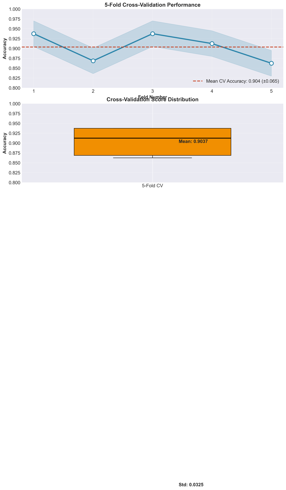
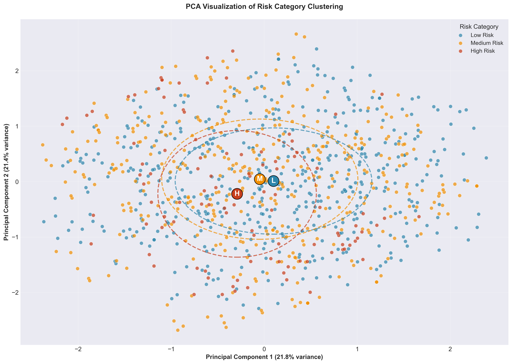
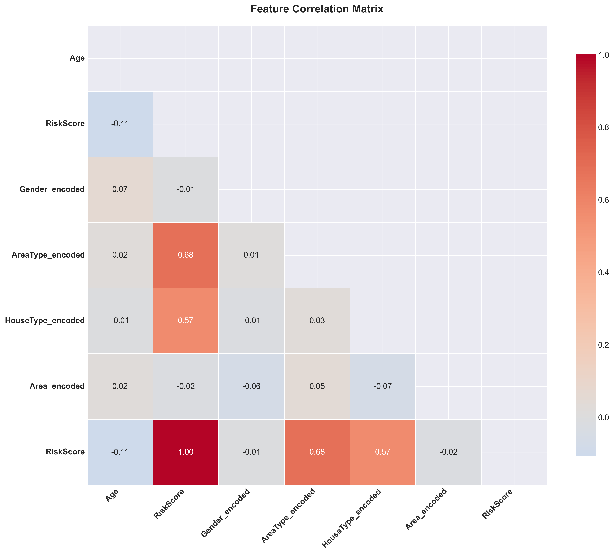
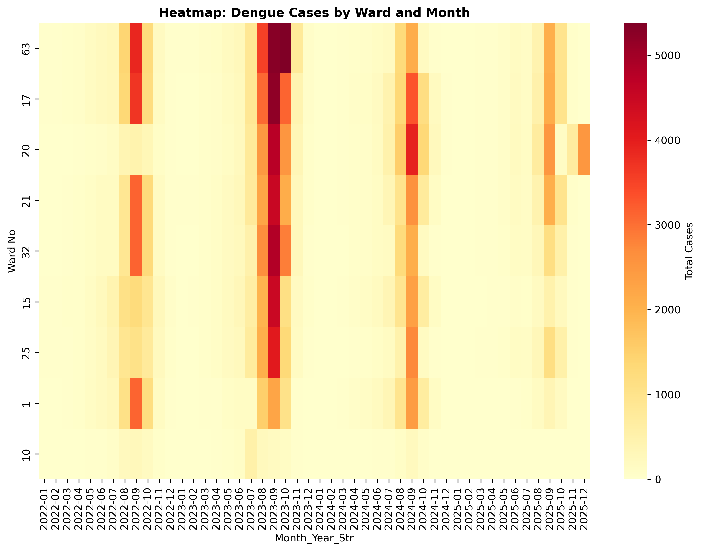
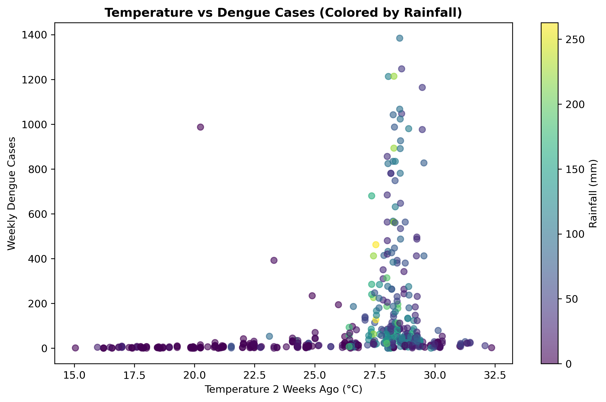
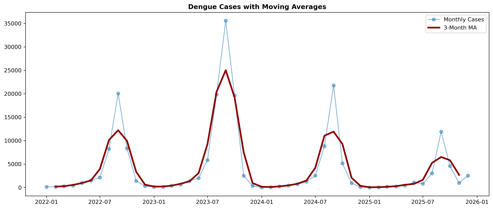

# Python Programming Practice

A structured collection of Python programming exercises, data analysis workflows, exploratory data analysis (EDA), machine learning experiments, and data visualization projects.

This repository documents my hands-on practice with Python and its data science ecosystem, focusing on writing reusable code, exploring datasets, analyzing patterns, and presenting insights through meaningful visualizations.

## Overview

- **Python Programming:** Core concepts, functions, data structures, and problem-solving.
- **Data Analysis:** Data exploration, preprocessing, and statistical analysis.
- **Exploratory Data Analysis (EDA):** Identifying patterns, distributions, and relationships in datasets.
- **Data Visualization:** Creating informative charts, heatmaps, and analytical plots.
- **Machine Learning Practice:** Feature analysis, model evaluation, cross-validation, and clustering.
- **Risk Analysis:** Exploring risk distributions, spatial patterns, and environmental relationships.

## Technologies & Libraries

- Python
- NumPy
- Pandas
- Matplotlib
- Seaborn
- Scikit-learn
- Jupyter Notebook

*Libraries are used where applicable across the exercises and projects.*

## Repository Structure

```text
Python-Programming-Practice/
│
├── images/
│   ├── 3_Risk_Distribution.png
│   ├── 3_spatial_risk_mapping.png
│   ├── 5_feature_importance.png
│   ├── 7_cross_validation.png
│   ├── 8_risk_clustering.png
│   ├── 9_correlation_heatmap.png
│   ├── Chart_3_Risk_Distribution.png
│   ├── Chart_4_Heatmap.png
│   ├── Chart_5_Environmental_Scatter.png
│   ├── Chart_7_Moving_Averages.png
│   ├── eda_visualizations.png
│   ├── feature_importance_plot.png
│   └── spatial_risk_map.png
│
├── [Python practice files and notebooks]
└── README.md
```

## Data Visualizations

This section showcases selected visual outputs from my data analysis and machine learning practice.


### 1. Cross-Validation

Showcases model evaluation results across cross-validation folds or experiments.



### 2. Risk Clustering

Visualizes risk-related groupings or clusters identified during exploratory analysis.



### 3. Correlation Analysis

A correlation heatmap for examining relationships among numerical variables.





### 4. Environmental Scatter Plot

Explores relationships between environmental variables and risk-related measurements.



### 5. Moving Average Analysis

Demonstrates moving averages for understanding trends and smoothing fluctuations in sequential data.




## Learning Objectives

- Strengthen Python programming and problem-solving skills.
- Develop practical data manipulation and analysis skills.
- Understand exploratory data analysis and statistical relationships.
- Create clear and informative visualizations.
- Explore feature importance and machine learning evaluation techniques.
- Maintain clean, organized, and reproducible code.

## Getting Started

### Prerequisites

- Python 3.x
- pip
- Jupyter Notebook or a Python-compatible IDE

### Installation

Clone the repository:

```bash
git clone https://github.com/afrin2326/Python-Programming-Practice.git
```

Navigate to the project directory:

```bash
cd Python-Programming-Practice
```

Create and activate a virtual environment (recommended):

**Windows**

```bash
python -m venv venv
venv\Scripts\activate
```

**Linux / macOS**

```bash
python3 -m venv venv
source venv/bin/activate
```

Install the libraries required by your selected exercise:

```bash
pip install numpy pandas matplotlib seaborn scikit-learn jupyter
```

Run Jupyter Notebook:

```bash
jupyter notebook
```

Open the relevant Python file or notebook and follow its instructions.

## Future Improvements

- Add more Python programming exercises.
- Expand data analysis and visualization examples.
- Include additional machine learning experiments.
- Improve documentation and reproducibility.
- Add explanations and results for individual projects.

## Author

**Mst Afrin Binte Amin**

- GitHub: [@afrin2326](https://github.com/afrin2326)
- LinkedIn: [Mst Afrin Binte Amin](https://www.linkedin.com/in/afrin-binte-amin-48a52b417/)

---

This repository is a continuous learning space for strengthening my Python, data analysis, and machine learning skills.

**If you find this repository useful, feel free to explore the code and follow my work.**
